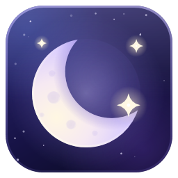

<p align="center"></p>

<h1 align="center">MoonStrap</h1>
<p align="center">A moon-themed Roblox launcher for Windows: a Bloxstrap-style bootstrapper for Roblox Player and Roblox Studio.</p>

## Features

- **Player and Studio.** Installs, updates and launches both, and can register itself as the handler for `roblox-player:` / `roblox-studio:` links, so joining from the website goes through MoonStrap.
- **Tweaks.** Use the dedicated GPU, pick the rendering API (Direct3D 11, Vulkan, OpenGL), anti-aliasing, exclusive fullscreen, and multiple Roblox windows at once.
- **FastFlags.** A JSON editor for `ClientAppSettings.json`, with **FPS Boost** and **Max FPS** presets built only from flags on Roblox's allowlist.
- **Mods.** Files in the Modifications folder are copied over the Roblox install; the originals are backed up and restored when you remove a mod.
- **Versions.** Stay on the latest build, or pin an older one from Roblox's deploy history (useful for testing).
- **Accounts.** Shows the Roblox accounts used on this PC with their avatars, plus an activity log. Login tokens are never read or touched.
- **MCP server.** `mcp/moonstrap_mcp.py` lets an AI assistant launch Roblox or Studio through MoonStrap (standard-library Python, stdio).

> Roblox only honours FastFlags on its allowlist, which contains graphics and display flags only. No flag can lower your ping.

## Install

Download `MoonStrap.exe` from the [latest release](../../releases/latest) and run it. It needs the [.NET 10 Desktop Runtime](https://dotnet.microsoft.com/download/dotnet/10.0).
MoonStrap adds itself to the Start Menu; its data lives in `%LOCALAPPDATA%\MoonStrap`.

## Build from source

Requires the .NET 10 SDK on Windows.

```
dotnet build -c Release
dotnet publish -c Release -r win-x64 --self-contained false -p:PublishSingleFile=true -o publish
```

## Command line

```
MoonStrap.exe -player [-version latest|0.710|version-<hash>]
MoonStrap.exe -studio
```

`-version` applies to that launch only and does not change your pinned version.

## Disclaimer

MoonStrap is an unofficial fan project and is not affiliated with or endorsed by Roblox Corporation.
